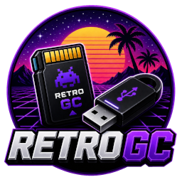

<div align="center">


# 🎮 Retro Game Card

**A portable, self-contained "game card" format for USB drives and SD cards.**
Plug one in, and your computer behaves like an old gaming console.

[](https://github.com/retrogc/retrogc-launcher)
[](https://github.com/retrogc/retrogc-launcher)
[](https://github.com/retrogc/retrogc-launcher)
[](https://github.com/retrogc/retrogc-launcher)

[🚀 Quick start](#-quick-start) · [📄 The .rgc format](#-the-rgc-card-format) · [🛠️ Platforms](#-supported-platforms) · [🧩 Making cards](#-creating-a-card) · [⚙️ Launcher](#-launcher-options)

</div>

---

## ✨ Key ideas

- **One game per card.** Each Retro Game Card is entirely self-contained: every file that game
  needs lives on the card itself.
- **Insert and play.** While the launcher is running, plugging in a card detects it and
  auto-launches the game through RetroArch.
- **Real shelf presence.** The launcher shows the cover art, title, platform, year and core, with
  status indicators for card detection and autostart, a retro cartridge shelf with modern polish.
- **Preservation-friendly.** A card is just files. Copy it, archive it, share it, and it keeps
  working years later.
- **Same card, many platforms.** A single `.rgc` describes both the RetroArch and the MiSTer
  FPGA launch paths.

---

## 🛠️ Supported platforms

| Platform | Runtime | Notes |
|---|---|---|
| **Windows** | x64 | Standalone launcher, self-contained build |
| **Linux** | x64 | Standalone launcher, self-contained build |
| **MiSTer FPGA** | - | Uses the `retrogc.sh` background script (no C# app) |

> The card format is identical across all three. The `.rgc` file carries both a `retroarch` and a
> `misterfpga` section, so the same card works on a PC and on a MiSTer.

---

## 🚀 Quick start

### Windows / Linux

1. **Download** the launcher from [releases](https://github.com/retrogc/retrogc-launcher/releases).
2. **Run** `retrogc-launcher`. On first launch it offers to download the RetroArch data package
   it needs (RetroArch itself, plus the cores; ≈700 MB per platform).
3. **Create** a Retro Game Card:
   - Linux: use the [retrogc-image.sh](Platforms/Linux/retrogc-image.sh) script to restore a compressed card image to an SD card, USB stick, ...
   - Windows: use [balena Etcher](https://etcher.balena.io/) app to restore a compressed card image to an SD card, USB stick, ...
4. **Insert** a Retro Game Card (SD card, USB stick, …) and enjoy.

The launcher keeps running in the background and in the system tray, so cards keep working
after you close the window.

> 💡 The data package can also be installed manually: download
> [retrogc-data-1.22.2-linux.zip](https://github.com/retrogc/retrogc-data/releases)
> (or the Windows equivalent), extract it over your data folder, and the launcher will use it
> instead of downloading.

### MiSTer FPGA

1. **Download** [retrogc.sh](https://raw.githubusercontent.com/retrogc/retrogc-launcher/refs/heads/main/Platforms/MisterFPGA/retrogc.sh).
2. **Copy** it to the MiSTer scripts directory: `/media/fat/Scripts/retrogc.sh`
3. **Make it executable:** `chmod a+x /media/fat/Scripts/retrogc.sh`
4. **Run it** from *Main menu → Scripts → retrogc.sh*. This toggles the background watcher, which
   also installs itself into `user-startup.sh` so it survives reboots.
5. **Read more:** [readme-misterfpga.txt](Platforms/MisterFPGA/readme-misterfpga.txt)

---

## 📄 The `.rgc` card format

A card is a **FAT32 volume labelled `RETROGC`** containing a single `.rgc` JSON file at its root,
plus the game files that file points to.

```
RETROGC/                     ← volume label
├── mygame.rgc               ← the card definition (required, at the root)
├── mario.png                ← cover art (optional)
└── games/
    └── nes/
        └── Super Mario Bros. (World).nes
```

> ⚠️ The launcher only looks for a `.rgc` file **at the root** of the volume, and only the **first**
> one it finds is used. Keep exactly one `.rgc` per card.

### Root fields

| Field | Type | Required | Description |
|---|:---:|:---:|---|
| `name` | string | ✅ **yes** | Display name of the game, shown in the launcher UI. |
| `description` | string | ➖ | Short blurb shown under the title. |
| `platform` | string | ➖ | Platform tag shown as a badge, e.g. `NES`, `CPS-1`, `PSX`. |
| `year` | string | ➖ | Release year shown as a badge, e.g. `1989`. |
| `image` | string | ➖ | Path to the cover art (a PNG), relative to the `.rgc` file. |
| `retroarch` | object | ✅ **yes** | How to launch the game with RetroArch. |
| `misterfpga` | object | ➖ | How to launch the game on a MiSTer FPGA. |

> ⚠️ `retroarch` is **mandatory**, a card without it is rejected by the launcher. The `misterfpga`
> section is optional in the file format, but a card is only useful on a MiSTer if it is present.

### `retroarch` object

| Field | Type | Required | Description |
|---|:---:|:---:|---|
| `core` | string | ✅ **yes** | Libretro core name **without** the platform extension, e.g. `nestopia`, `fbneo`, `swanstation`. The launcher appends `_libretro.dll` (Windows) or `_libretro.so` (Linux). |
| `roms` | string[] | ✅ **yes** | Paths to the ROM(s), relative to the `.rgc`. The **first** entry is the one RetroArch is launched with; extra entries are additional files that must be present on the card (e.g. a second PSX disc). |
| `version` | string | ✅ **yes** | RetroArch version the card was built against, e.g. `1.22.2`. Shown in the UI; the launcher falls back to its own version when they differ. |
| `runtimes` | string[] | ➖ | Extra *system* files (BIOSes) copied into RetroArch's `system` folder at launch, e.g. `games/neogeo/neogeo.zip`. |

### `misterfpga` object

| Field | Type | Required | Description |
|---|:---:|:---:|---|
| `core` | string | ✅ **yes** | Path to the MiSTer `.rbf` core, relative to the **SD card root**, e.g. `_Console/NES_20260603.rbf`. |
| `roms` | string[] | ✅ **yes** | Paths to the ROM(s), relative to the **SD card root**. The **first** entry is the one loaded. For arcade games this is usually a `.mra` file. |
| `runtimes` | string[] | ➖ | Additional system files needed by the core (Neo Geo BIOS, PSX boot ROMs, …). |
| `delay` | string | ➖ | Load delay written into the generated `.mgl`. Defaults to `1` when missing. |
| `index` | string | ➖ | ROM index written into the generated `.mgl`. Defaults to `1` when missing. |
| `type` | string | ➖ | ROM type written into the generated `.mgl`. `f` for file, `s` for stream. Defaults to `f` when missing. |

> 💡 `delay`, `index` and `type` are **only** used by the MiSTer script, and only for non-`.mra`
> ROMs. Arcade `.mra` games are loaded directly by their core and ignore them.

> ⚠️ **Path bases differ between the two sections.** `retroarch` paths are relative to the `.rgc`
> file, while `misterfpga` paths are relative to the **SD card root**, because the MiSTer core
> and `.mra` files live in the MiSTer's own `_Console` / `_Arcade` folders. The example below shows
> both.

### Path rules

- Every path inside a `.rgc` is **relative**, never absolute.
- `retroarch` paths may **not** escape the card directory (`../` is rejected).
- The cover art file named in `image` is looked up relative to the `.rgc`, and is optional: if the
  file is missing the launcher simply shows a "no preview" placeholder.

### Example

```json
{
  "name": "Super Mario Bros",
  "description": "Mario and Luigi race to rescue Princess Peach from the evil Bowser...",
  "platform": "NES",
  "year": "1989",
  "image": "mario.png",
  "retroarch": {
    "version": "1.22.2",
    "core": "nestopia",
    "roms": [
      "games/nes/Super Mario Bros. (World).nes"
    ]
  },
  "misterfpga": {
    "core": "_Console/NES_20260603.rbf",
    "roms": [
      "games/nes/Super Mario Bros. (World).nes"
    ],
    "delay": "2",
    "index": "1",
    "type": "f"
  }
}
```

Ready-made examples live in the [Cards](Cards) folder. Treat them as the authoritative
reference. Complete, prebuilt cards are available in the
[retrogc-gamecards](https://github.com/retrogc/retrogc-gamecards) repository.

---

## 🧩 Creating a card

1. **Copy** one of the `.rgc` files from the [Cards](Cards) folder and adapt it to your game.
2. **Add** the game files it references, keeping the folder layout intact.
3. **Write** it to a FAT32 volume labelled **`RETROGC`**. That label is what the launcher looks for.
4. **Plug it in.** The launcher detects the card and auto-launches.

### Building a card image (Linux)

The [retrogc-image.sh](Platforms/Linux/retrogc-image.sh) script builds a compressed card image
from a folder, or restores one onto a device:

```bash
# folder → image
./retrogc-image.sh --build ~/my-card my-card.img.xz

# image → SD card / USB drive
./retrogc-image.sh --restore my-card.img.xz /dev/sdb
```

The build produces a FAT32 image with the `RETROGC` label, compressed with `xz`. The restore step
**overwrites the target device completely**, it asks for confirmation first.

> 🔧 **Dependencies:** `parted`, `mkfs.fat`, `mount`, `umount`, `rsync`, `xz`, `truncate` and
> `mcopy` (from `mtools`) for building; `xzcat`, `dd` and `lsblk` for restoring.

---

## 🔍 How auto-launch works

1. The launcher **polls removable volumes** for one labelled `RETROGC`.
2. It finds the `.rgc` at the volume root and **parses** it.
3. It resolves the cover art, the ROM and the RetroArch core, and copies any `runtimes` (BIOS
   files) into RetroArch's `system` folder.
4. It **launches RetroArch** with that core and ROM, applying your fullscreen, integer-scaling
   and shader settings.
5. When the card is removed, RetroArch is closed and the launcher returns to its waiting state.

<details>
<summary>Keyboard shortcuts</summary>

| Key | Action |
|---|---|
| <kbd>F11</kbd> | Toggle fullscreen / windowed |
| <kbd>Esc</kbd> | Toggle fullscreen / windowed |
| <kbd>F12</kbd> | Open the settings window |

</details>

---

## ⚙️ Launcher options

Press <kbd>F12</kbd> (or the tray icon → *Settings*) to configure:

- **Startup window state**: fullscreen, windowed, or minimized.
- **Start RetroArch fullscreen.**
- **Integer scaling**: for crisp pixels on modern displays.
- **Shader**: `None`, `Bilinear`, `Crt`, `Retro` or `Scanline`.
- **Custom RetroArch executable**: use your own RetroArch instead of the bundled one.

### Where things are stored

| What | Where |
|---|---|
| Settings | `~/.local/share/retrogc/settings.json` (Linux) · `%LOCALAPPDATA%\retrogc\settings.json` (Windows) |
| RetroArch data | `<settings folder>/data/<retroarch version>/` |

---

## 💡 Tips

- **Multi-disc PSX games**: list every disc file in `roms`; only the first is launched, the rest
  are just required to be present.
- **Neo Geo / arcade systems**: put the BIOS `neogeo.zip` in `retroarch.runtimes` so the launcher
  copies it into RetroArch's `system` folder on every launch.
- **Core availability**: the bundled data package ships with the cores used by the example
  cards. A card naming a core that isn't installed simply fails to launch.

---

## 🧑‍💻 Building from source

```bash
git clone https://github.com/retrogc/retrogc-launcher.git
cd retrogc-launcher
dotnet build
dotnet run
```

Requires the **.NET 10 SDK**. The project targets `net10.0` and uses
[Avalonia](https://avaloniaui.net/) 12 for the cross-platform UI.

---

## 🤝 Contributing

Contributions are welcome! Whether it's adding more example cards, improving the build scripts, or
polishing the launcher UX (more icons, extra colour themes, screenshots), please open an issue or
a pull request.

---

## 📄 License

See the project's `LICENSE` file for details.
