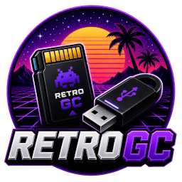
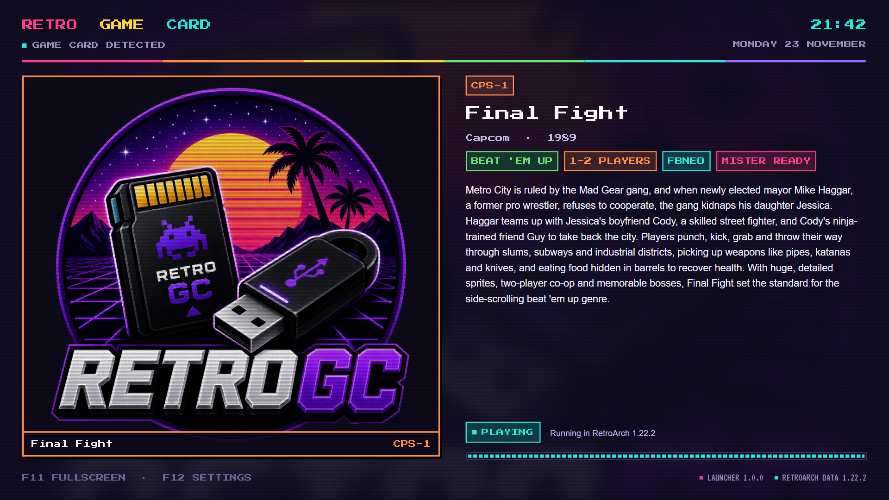
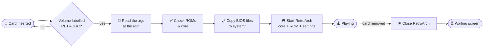
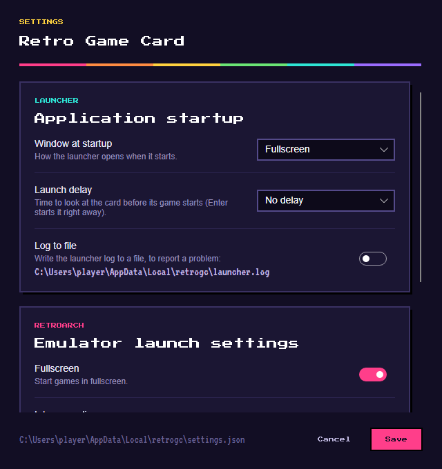
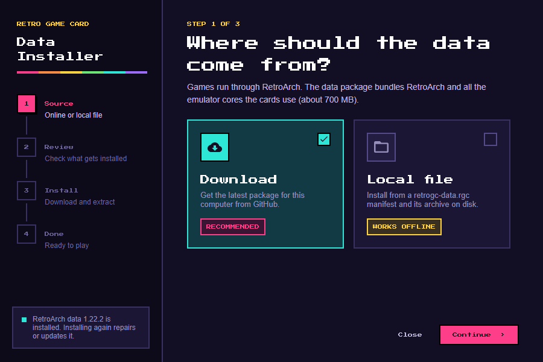
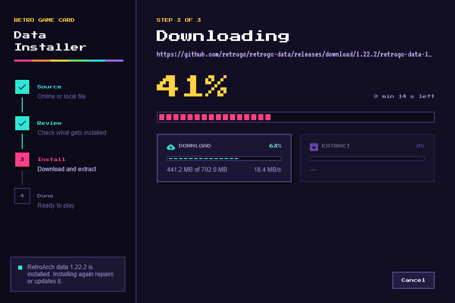

<div align="center">



# Retro Game Card

### 🕹️ Plug in a card. Play the game. That's it.

A portable, self-contained **game card** format for USB sticks and SD cards,
and a launcher that turns any computer into a plug-and-play retro console.

[](https://github.com/retrogc/retrogc-launcher/releases)
[](#%EF%B8%8F-supported-platforms)
[](#%EF%B8%8F-supported-platforms)
[](#-mister-fpga)
[](#-recalbox)

[](https://dotnet.microsoft.com/)
[](https://avaloniaui.net/)
[](https://www.retroarch.com/)
[](LICENSE)

**[🚀 Quick start](#-quick-start)** ·
**[🎴 Card format](#-the-rgc-card-format)** ·
**[🧩 Make a card](#-creating-a-card)** ·
**[💳 Installer card](#-installer-cards)** ·
**[⚙️ Settings](#%EF%B8%8F-settings)** ·
**[❓ FAQ](#-faq--troubleshooting)** ·
**[🧑‍💻 Build](#-building-from-source)**

<br />



</div>

---

## ✨ Why Retro Game Card?

<table>
<tr>
<td width="50%" valign="top">

### 💾 One game, one card
Everything a game needs lives **on the card**: ROMs, BIOS files, cover art and a
small `.rgc` description file. Nothing to configure on the computer.

</td>
<td width="50%" valign="top">

### ⚡ Insert and play
The launcher watches your drives. Plug a card in and the game **starts automatically**.
Pull it out and you're back to the waiting screen.

</td>
</tr>
<tr>
<td valign="top">

### 🖼️ Real shelf presence
Cover art, title, platform, year, developer and genre on a polished,
TV-friendly fullscreen screen. A modern take on the cartridge shelf.

</td>
<td valign="top">

### 🔁 Same card, everywhere
A single `.rgc` file describes both the **RetroArch** (Windows / Linux / Recalbox)
and the **MiSTer FPGA** launch, so one card works on a PC, a Recalbox *and* a MiSTer.

</td>
</tr>
<tr>
<td valign="top">

### 🗃️ Preservation friendly
A card is just files on a FAT32 volume. Copy it, back it up, share it as a
compressed image: it keeps working years later.

</td>
<td valign="top">

### 📦 Batteries included
One installer card (or a guided download) sets up RetroArch and every emulator core for you,
even offline. No RetroArch knowledge needed.

</td>
</tr>
</table>

---

## 🖥️ Supported platforms

| | Platform | What you run | Notes |
|:-:|---|---|---|
| 🪟 | **Windows** x64 | `retrogc-launcher.exe` | Standalone, self-contained build |
| 🐧 | **Linux** x64 | `retrogc-launcher` | Standalone, self-contained build |
| 🔲 | **MiSTer FPGA** | `retrogc.sh` | Background script, no desktop app needed |
| 🟦 | **Recalbox** | `retrogc.sh` | Background script, games start through Recalbox (🧪 new) |

> [!NOTE]
> The card format is **identical** everywhere. Each `.rgc` file carries a `retroarch` section
> (Windows / Linux / Recalbox) and an optional `misterfpga` section.

---

## 🚀 Quick start

### 🪟 🐧 Windows & Linux

#### 💳 Recommended: the installer card

The easiest way: one USB stick that installs **everything** (launcher, RetroArch and all the
emulator cores), **with no internet connection needed**.

| Step | |
|:-:|---|
| **1️⃣ Download** | Get `retrogc-installer-<version>.img.xz` from the [**retrogc-installer releases**](https://github.com/retrogc/retrogc-installer/releases/latest) (≈ 1.5 GB). |
| **2️⃣ Flash** | Write it to a USB stick of **2 GB or more** with [**balenaEtcher**](https://etcher.balena.io/) (Windows, Linux, macOS), or `./retrogc-image.sh --restore` on Linux (see [Writing a card image](#-writing-a-card-image)). ⚠️ This erases the stick. |
| **3️⃣ Install** | Open the stick and run `retrogc-launcher.exe` (Windows) or `retrogc-launcher` (Linux), then click **Install**. The launcher installs itself with a menu shortcut, installs RetroArch and its cores, then restarts from the installed copy. |
| **4️⃣ Play** | Remove the stick, insert a [game card](#-the-rgc-card-format) and the game starts on its own. 🎉 Ready-made cards live in [**retrogc-gamecards**](https://github.com/retrogc/retrogc-gamecards). |

> [!TIP]
> Keep the stick: it sets up any other computer the same way, and inserting it where the launcher
> is already installed offers to **update** the launcher and the data.

> [!NOTE]
> 🐧 On Linux the stick is mounted at `/media/<user>/RETROGC` (Ubuntu) or `/run/media/<user>/RETROGC`.
> If double-clicking `retrogc-launcher` doesn't start it, right-click it → **Run as a Program**, or
> run it from a terminal: `/media/$USER/RETROGC/retrogc-launcher`.

#### 📥 Manual install

Prefer a plain download? The launcher fetches RetroArch and its cores itself on first launch.

| Step | |
|:-:|---|
| **1️⃣ Download** | Grab the launcher for your system from the [**releases page**](https://github.com/retrogc/retrogc-launcher/releases). |
| **2️⃣ Run** | Start `retrogc-launcher`. On first launch the **data installer** opens and downloads RetroArch and its cores (≈ 700 MB). |
| **3️⃣ Get a card** | Write a card image to a USB stick or SD card (see [Writing a card image](#-writing-a-card-image)), or [make your own](#-creating-a-card). Ready-made cards live in [**retrogc-gamecards**](https://github.com/retrogc/retrogc-gamecards). |
| **4️⃣ Play** | Insert the card. The game starts on its own. 🎉 |

<details>
<summary><b>📥 Installing the data package by hand (offline machines)</b></summary>

<br />

1. Download the archive for your system from
   [**retrogc-installer releases**](https://github.com/retrogc/retrogc-installer/releases),
   e.g. `retrogc-data-1.22.2-linux.zip`.
2. Either:
   - open the installer (<kbd>F12</kbd> → **RetroArch data package** → **Install…**), choose
     **Local file** and pick the `retrogc-data.rgc` manifest sitting next to the archive, **or**
   - extract the archive yourself into `<data folder>/1.22.2/`
     (see [Where things are stored](#-where-things-are-stored)).

Or simply use the [installer card](#-recommended-the-installer-card), which works offline.

</details>

> [!TIP]
> Closing the window doesn't quit: the launcher keeps running in the **system tray** so cards
> keep working. Use the tray menu → **Exit** to really quit.

### 🔲 MiSTer FPGA

1. **Download** [`retrogc.sh`](https://raw.githubusercontent.com/retrogc/retrogc-launcher/refs/heads/main/Platforms/MisterFPGA/retrogc.sh).
2. **Copy** it to `/media/fat/Scripts/retrogc.sh` and make it executable:
   ```bash
   chmod a+x /media/fat/Scripts/retrogc.sh
   ```
3. **Run** it from *Main menu → Scripts → retrogc.sh*.

Running the script **toggles** the background watcher:

| | When turned **ON** | When turned **OFF** |
|:-:|---|---|
| 🪝 | Installs a hook in `/media/fat/linux/user-startup.sh` | Removes the hook |
| 👀 | Starts watching for cards right away | Stops the watcher |
| 🔄 | Starts again automatically on every boot | Cleans up and returns to the menu core |

📖 More details in [`readme-misterfpga.txt`](Platforms/MisterFPGA/readme-misterfpga.txt).

### 🟦 Recalbox

> [!NOTE]
> 🧪 Recalbox support is new: please report what works (and what doesn't) on your board.

1. **Download** [`retrogc.sh`](https://raw.githubusercontent.com/retrogc/retrogc-launcher/refs/heads/main/Platforms/Recalbox/retrogc.sh).
2. **Copy** it to `/recalbox/share/system/retrogc/retrogc.sh`, over the network share
   (`\\RECALBOX\share\system\retrogc\`) or SSH.
3. **Enable** it over SSH (user `root`, password `recalboxroot`):
   ```bash
   chmod +x /recalbox/share/system/retrogc/retrogc.sh
   /recalbox/share/system/retrogc/retrogc.sh --enable
   ```

The watcher starts now and at every boot (hook in `/recalbox/share/system/custom.sh`). Insert a card:
EmulationStation closes and the game starts; remove it and EmulationStation comes back.
`--disable` turns it off, `--status` shows its state.

| | How the game is started |
|:-:|---|
| ✅ | With [`retroarch.system`](#%EF%B8%8F-retroarch-object) set, through **Recalbox's own launcher** (controllers and video set up like a game started from EmulationStation). |
| ↩️ | Without it, **RetroArch directly** with the card's core and Recalbox's RetroArch config. |

📖 More details in [`readme-recalbox.txt`](Platforms/Recalbox/readme-recalbox.txt).

---

## 🎴 The `.rgc` card format

A **game card** is a **FAT32 volume labelled `RETROGC`** with one `.rgc` JSON file at its root,
plus the files it points to. FAT32 keeps it readable everywhere, MiSTer included.

```text
📀 RETROGC/                         ← volume label (required)
├── 📄 mygame.rgc                   ← card definition (required, at the root)
├── 🖼️ mygame.png                   ← cover art (optional)
└── 📁 games/
    └── 📁 nes/
        └── 🎮 Super Mario Bros. (World).nes
```

> [!IMPORTANT]
> Only a `.rgc` file **at the root** of the volume is read, and only the **first one** found.
> Keep exactly one `.rgc` per card.

> [!NOTE]
> A card with a `retrogc-data.rgc` file at its root is an [**installer card**](#-installer-cards)
> instead: it installs the launcher and RetroArch, it doesn't start a game.

### 🏷️ Root fields

| Field | Type | Required | Description |
|---|:-:|:-:|---|
| `name` | string | ✅ | Game title shown on screen. |
| `description` | string | | Short blurb shown under the title. |
| `platform` | string | | Platform tag, e.g. `NES`, `CPS-1`, `PSX`. |
| `year` | string | | Release year, e.g. `1989`. |
| `image` | string | | Cover art (PNG), relative to the `.rgc` file. |
| `developer` | string | | 🆕 Developer / studio, e.g. `Capcom`. |
| `genre` | string | | 🆕 Genre badge, e.g. `Beat 'em up`. |
| `players` | string | | 🆕 Player count badge, e.g. `1-2`. |
| `retroarch` | object | ✅ | How to launch the game with RetroArch ⬇️ |
| `misterfpga` | object | | How to launch the game on a MiSTer ⬇️ |

> [!NOTE]
> 🆕 `developer`, `genre` and `players` are **display-only**, and `retroarch.system` is only read on
> Recalbox. They're fully backward compatible: older launchers and the MiSTer script just ignore them,
> and cards without them work as before.

### 🕹️ `retroarch` object

| Field | Type | Required | Description |
|---|:-:|:-:|---|
| `core` | string | ✅ | Libretro core name **without** suffix, e.g. `nestopia`, `fbneo`, `swanstation`. The launcher adds `_libretro.dll` (Windows) or `_libretro.so` (Linux). |
| `roms` | string[] | ✅ | ROM file(s), relative to the `.rgc`. The **first** one is launched; the others must exist (e.g. extra PSX discs). |
| `version` | string | ✅ | RetroArch version the card was made for, e.g. `1.22.2`. If it isn't installed, the newest installed version is used. Ignored on Recalbox. |
| `system` | string | | 🆕 [Recalbox system name](https://wiki.recalbox.com/en/tutorials/themes/tree/systems-list), e.g. `nes`, `neogeo`, `psx`, `fbneo`. Lets Recalbox start the game with its own launcher. Ignored by the desktop launcher. |
| `runtimes` | string[] | | System / BIOS files copied into RetroArch's `system` folder before launch (`/recalbox/share/bios` on Recalbox), e.g. `games/neogeo/neogeo.zip`. |

> [!TIP]
> 🟦 **Recalbox system names**: `system` is the Recalbox short name of the system, the same as its
> ROM folder in `/recalbox/share/roms/` (e.g. `nes`, `snes`, `megadrive`, `neogeo`, `psx`, `fbneo`,
> `amiga600`). The full list is in the official
> [**Recalbox systems list**](https://wiki.recalbox.com/en/tutorials/themes/tree/systems-list).
> Pick a system whose emulators include the card's libretro `core`: Recalbox uses that core for the
> game. Without `system` (or with an unknown one), the Recalbox script starts RetroArch directly
> with the core instead.

### 🔲 `misterfpga` object

| Field | Type | Required | Description |
|---|:-:|:-:|---|
| `core` | string | ✅ | `.rbf` core, relative to the **SD card root**, e.g. `_Console/NES_20260603.rbf`. |
| `roms` | string[] | ✅ | ROM file(s), relative to the **SD card root**. The first one is loaded; arcade games usually point to a `.mra`. |
| `runtimes` | string[] | | Extra system files needed by the core (Neo Geo BIOS, PSX boot ROMs…). |
| `delay` | string | | Load delay written to the generated `.mgl`. Default `1`. |
| `index` | string | | ROM index written to the generated `.mgl`. Default `1`. |
| `type` | string | | ROM type for the `.mgl`: `f` (file) or `s` (stream). Default `f`. |

> [!TIP]
> `delay`, `index` and `type` only matter for non-`.mra` ROMs on MiSTer. Arcade `.mra` files are
> loaded directly and ignore them.

### 🧭 Path rules

| | Rule |
|:-:|---|
| 📐 | Every path in a `.rgc` is **relative**, never absolute. |
| 🔒 | `retroarch` paths are relative to the `.rgc` file and **can't escape** the card (`../` is rejected). |
| 🔀 | `misterfpga` paths are relative to the **SD card root**, because MiSTer cores and `.mra` files live in its own `_Console` / `_Arcade` folders. |
| 🖼️ | A missing `image` is fine: a placeholder is shown instead. |

### 📝 Example

<details open>
<summary><b>Full card</b>, every field</summary>

```json
{
  "name": "Super Mario Bros",
  "description": "Mario and Luigi race to rescue Princess Peach from the evil Bowser...",
  "platform": "NES",
  "year": "1989",
  "image": "mario.png",
  "developer": "Nintendo",
  "genre": "Platformer",
  "players": "1-2",
  "retroarch": {
    "version": "1.22.2",
    "system": "nes",
    "core": "nestopia",
    "roms": [
      "games/nes/Super Mario Bros. (World).nes"
    ]
  },
  "misterfpga": {
    "core": "_Console/NES_20260603.rbf",
    "roms": [
      "games/nes/Super Mario Bros. (World).nes"
    ],
    "delay": "2",
    "index": "1",
    "type": "f"
  }
}
```

</details>

<details>
<summary><b>Minimal card</b>, RetroArch only</summary>

```json
{
  "name": "Super Mario Bros",
  "retroarch": {
    "version": "1.22.2",
    "core": "nestopia",
    "roms": [ "games/nes/Super Mario Bros. (World).nes" ]
  }
}
```

</details>

📚 More examples in the [**Cards**](Cards) folder (the reference), and complete prebuilt cards in
[**retrogc-gamecards**](https://github.com/retrogc/retrogc-gamecards).

---

## 🧩 Creating a card

1. 📋 **Copy** a `.rgc` from the [Cards](Cards) folder and adapt it to your game.
2. 📁 **Add** the files it references, keeping the folder layout.
3. 💾 **Format** a USB stick / SD card as **FAT32** with the label **`RETROGC`** and copy everything to it,
   or build an image (below).
4. 🔌 **Plug it in.** If something is wrong, the launcher shows the reason on screen.

### 💿 Card images (Linux)

[`retrogc-image.sh`](Platforms/Linux/retrogc-image.sh) builds, writes and unpacks compressed card images:

```bash
# 📦 folder → compressed image (FAT32, labelled RETROGC, xz compressed)
./retrogc-image.sh --build ~/my-card my-card.img.xz

# 🔥 image → USB stick / SD card  (⚠️ erases the whole device, asks first)
./retrogc-image.sh --restore my-card.img.xz /dev/sdb

# 📂 image → folder (inspect or edit an existing card)
./retrogc-image.sh --extract my-card.img.xz ./my-card
```

<details>
<summary><b>🔧 Dependencies</b></summary>

| Mode | Tools |
|---|---|
| `--build` | `parted` `mkfs.fat` `xz` `truncate` `mcopy` |
| `--build-installer` | `curl` `jq` `unzip` `xz` `parted` `truncate`, plus `mkfs.exfat` (exfatprogs) `losetup` `mount` `sudo`, or `mkfs.fat` `mcopy` with `--fat32` |
| `--restore` | `xzcat` `dd` `lsblk` |
| `--list` | `lsblk` `awk` |
| `--extract` | `xz` `mcopy` `find` `mktemp` `realpath` (FAT32 images only) |

`mcopy` comes from the **mtools** package.

</details>

<details>
<summary><b>🔌 Which device is my card?</b></summary>

<br />

`./retrogc-image.sh --list` shows only the USB drives (size, model, label, mount point), so you
can pick the right `/dev/sdX` for `--restore`.

</details>

### 🔥 Writing a card image

Game cards and installer cards are flashed the same way. ⚠️ Flashing erases the whole stick / SD card.

| | How |
|:-:|---|
| 🖱️ **Any system** | Open the `.img.xz` with [**balenaEtcher**](https://etcher.balena.io/) (Windows, Linux, macOS), pick the stick and flash it |
| 🐧 **Linux (terminal)** | `./retrogc-image.sh --list` to find the stick, then `./retrogc-image.sh --restore game.img.xz /dev/sdX` |

---

## 💳 Installer cards

An installer card carries the **launcher itself** (Windows and Linux on the same card) and the
**RetroArch data package**, to set up a computer offline in one go, or to update one.

> [!TIP]
> You don't need to make one: a ready-to-flash image, `retrogc-installer-<version>.img.xz`, is
> published with every [**retrogc-installer release**](https://github.com/retrogc/retrogc-installer/releases/latest).
> See the [Quick start](#-recommended-the-installer-card). The rest of this section explains how it works.

**Content** (exFAT volume labelled `RETROGC`):

```text
📀 RETROGC/
├── 📄 retrogc-data.rgc                  ← data manifest (marks the card as an installer card)
├── 📦 retrogc-data-1.22.2-windows.zip
├── 📦 retrogc-data-1.22.2-linux.zip
├── 🪟 retrogc-launcher.exe
└── 🐧 retrogc-launcher
```

`retrogc-data.rgc` is the same manifest as the [online one](https://github.com/retrogc/retrogc-installer),
except that `url` points to the archive **on the card** (a relative path):

```json
{
  "default": "1.22.2",
  "versions": [
    {
      "version": "1.22.2",
      "platforms": {
        "win-x64": {
          "data": [
            { "name": "retrogc-data", "file": "retrogc-data-1.22.2-windows.zip", "url": "retrogc-data-1.22.2-windows.zip" },
            { "name": "retrogc-launcher", "version": "1.0.4", "file": "retrogc-launcher.exe", "url": "retrogc-launcher.exe" }
          ]
        },
        "linux-x64": {
          "data": [
            { "name": "retrogc-data", "file": "retrogc-data-1.22.2-linux.zip", "url": "retrogc-data-1.22.2-linux.zip" },
            { "name": "retrogc-launcher", "version": "1.0.4", "file": "retrogc-launcher", "url": "retrogc-launcher" }
          ]
        }
      }
    }
  ]
}
```

> [!NOTE]
> The `retrogc-launcher` entries are optional: without them the launcher is still found by its file
> name at the card root, but its version is unknown, so no launcher update is offered automatically.

### 🆕 New computer: run the launcher from the card

1. Insert the card and start `retrogc-launcher` (or `retrogc-launcher.exe`) **from the card**.
2. The installer opens with the card's manifest selected. The review step lists the **launcher**
   and the **data package**, each with its own switch.
3. **Install** copies the launcher to the [install folder](#-where-things-are-stored), creates the
   application menu shortcut (Start Menu on Windows, app grid on Linux) and installs the data.
4. The installed launcher starts and the card copy exits: the card can be removed.

### 🔄 Already installed: just insert the card

When the running launcher sees an installer card, it shows it on screen instead of a game, with
the versions it carries. If the card brings something new (data not installed yet, or a newer
launcher), the installer opens and asks what to update. Otherwise press <kbd>Enter</kbd> to
reinstall anyway. After a launcher update, the launcher restarts on the new version.

> [!WARNING]
> 🐧 Linux mounts **FAT32** volumes without the executable bit (only `.exe` / `.bat` files are
> executable), so `retrogc-launcher` can't be started straight from a FAT32 card. That's why
> installer cards are **exFAT** (they aren't used by MiSTer). On a FAT32 copy, copy the file to your
> home folder first.

### 🛠️ Building your own installer card (optional)

Only needed for a custom card (your own launcher build, another data version…): the official one
is built by the [retrogc-installer release workflow](https://github.com/retrogc/retrogc-installer/actions).
[`retrogc-image.sh`](Platforms/Linux/retrogc-image.sh) builds a ready-to-flash installer card image.
By default it downloads the latest launcher release and the data archives listed in the
[online manifest](https://github.com/retrogc/retrogc-installer), writes the card's `retrogc-data.rgc`
and formats the card as **exFAT** (asks for `sudo` to loop-mount the image):

```bash
# 💳 latest launcher + latest data (≈ 1.4 GB download), exFAT
./retrogc-image.sh --build-installer retrogc-installer.img.xz

# 📎 FAT32 instead (no sudo, but see the warning above)
./retrogc-image.sh --build-installer retrogc-installer.img.xz --fat32

# 🧪 your own launcher builds and an offline data manifest (archives next to it)
./retrogc-image.sh --build-installer retrogc-installer.img.xz \
    --launcher-linux publish/linux/retrogc-launcher \
    --launcher-windows publish/windows/retrogc-launcher.exe \
    --launcher-version 1.0.4 \
    --data ~/retrogc-data/retrogc-data.rgc
```

Without `--launcher-version`, local launchers are written without a version, so already installed
launchers aren't offered them as an update. Flash the image like any other card (`--restore`, or
balenaEtcher on Windows).

---

## 🔍 How auto-launch works



1. The launcher checks the removable drives twice a second for a volume labelled `RETROGC`.
2. It reads the `.rgc` at the root and shows the game on screen. (A card with `retrogc-data.rgc`
   at its root is shown as an [installer card](#-already-installed-just-insert-the-card) instead.)
3. It checks every ROM and the core, then copies the `runtimes` (BIOS) files into RetroArch's
   `system` folder, but only when they changed.
4. It starts RetroArch with the core and the ROM, using your fullscreen, scaling and shader settings.
5. When the card is pulled out, RetroArch is asked to close (and is stopped after 3 seconds if
   needed), then the launcher goes back to waiting.

> [!TIP]
> Quit RetroArch while the card is still in? Press <kbd>Enter</kbd> on the launcher to play again.

---

## ⌨️ Controls

| Key | Action |
|:-:|---|
| <kbd>F11</kbd> / <kbd>Esc</kbd> | Toggle fullscreen / windowed |
| <kbd>F12</kbd> | Open the settings |
| <kbd>Enter</kbd> / <kbd>Space</kbd> | Relaunch the inserted card (after RetroArch was closed or failed), or open the installer for an inserted installer card |

From the **tray icon**: click to show the launcher, or right-click for **Open**, **Settings** and **Exit**.

---

## ⚙️ Settings

Press <kbd>F12</kbd> (or tray icon → **Settings**).

<div align="center">

</div>

| Setting | Default | What it does |
|---|:-:|---|
| 🪟 **Window at startup** | Fullscreen | Open the launcher fullscreen, windowed, or minimized to the tray. |
| 🖥️ **Fullscreen** | On | Start games in fullscreen. |
| 📐 **Integer scaling** | Off | Scale by whole numbers for perfectly even pixels. |
| ✨ **Shader** | Bilinear | `None` (sharp pixels), `Bilinear` (smooth), `CRT`, `Retro LCD` or `Scanlines`. |
| 🛠️ **Custom RetroArch executable** | Off | Use your own RetroArch binary instead of the bundled one. |
| 📦 **RetroArch data package** | n/a | Install, repair or update RetroArch and its cores. |

### 📦 The data installer

A guided installer downloads RetroArch and every emulator core the cards use, either **from
GitHub** or **from a local file** for offline machines. It shows speed and time left, can be
cancelled at any time, and never deletes files that aren't part of the package (your saves
are safe when reinstalling).

<div align="center">


</div>

### 📂 Where things are stored

| What | 🐧 Linux | 🪟 Windows |
|---|---|---|
| Settings | `~/.local/share/retrogc/settings.json` | `%LOCALAPPDATA%\retrogc\settings.json` |
| RetroArch data | `~/.local/share/retrogc/data/<version>/` | `%LOCALAPPDATA%\retrogc\data\<version>\` |
| Temporary downloads | `~/.local/share/retrogc/downloads/` | `%LOCALAPPDATA%\retrogc\downloads\` |
| Launcher (from an installer card) | `~/.local/share/retrogc/app/` | `%LOCALAPPDATA%\retrogc\app\` |
| Application shortcut | `~/.local/share/applications/retrogc-launcher.desktop` | Start Menu → **Retro Game Card** |

---

## ❓ FAQ & troubleshooting

<details>
<summary><b>The card isn't detected</b></summary>

<br />

- Check the volume label is exactly **`RETROGC`**.
- 🐧 On Linux, the card must be **mounted** with a folder named after its label (desktop auto-mounters
  do this, e.g. `/run/media/<user>/RETROGC`).
- 🪟 On Windows, the drive's **volume label** is used.

</details>

<details>
<summary><b>The launcher on the installer card doesn't start (Linux)</b></summary>

<br />

- Some file managers don't run programs on double-click: right-click `retrogc-launcher` →
  **Run as a Program**, or start it from a terminal: `/media/$USER/RETROGC/retrogc-launcher`
  (`/run/media/$USER/RETROGC/...` on some distributions).
- "Permission denied": the card is FAT32 (e.g. a hand-made copy). Copy `retrogc-launcher` to your
  home folder, `chmod +x` it and run it from there, or flash the official exFAT image.

</details>

<details>
<summary><b>The game doesn't start</b></summary>

<br />

The reason is shown in red on the launcher screen. The most common ones:

- **Core not installed**: the `retroarch.core` name is wrong, or the data package is missing
  (<kbd>F12</kbd> → **RetroArch data package**).
- **Missing game file**: a path in `roms` or `runtimes` doesn't match the card's content
  (paths are case-sensitive on Linux).
- **No .rgc found**: the `.rgc` file must be at the **root** of the card.

</details>

<details>
<summary><b>Recalbox: the game doesn't start</b></summary>

<br />

Every step is logged to `/tmp/retrogc-launcher.log` (read it over SSH). Check that the card's
`retroarch.core` exists in `/usr/lib/libretro/` on your Recalbox, and that `retroarch.system` is a
Recalbox system name. `retrogc.sh --status` tells whether the watcher is running.

</details>

<details>
<summary><b>Multi-disc PSX games</b></summary>

<br />

List every disc file in `roms`. Only the first is launched; the others just need to be there.
See [`psx-metal-gear-solid.rgc`](Cards/psx-metal-gear-solid.rgc).

</details>

<details>
<summary><b>Neo Geo and other BIOS-based systems</b></summary>

<br />

Put the BIOS (e.g. `neogeo.zip`) on the card and list it in `retroarch.runtimes`. It's copied to
RetroArch's `system` folder before every launch. See [`neogeo-metal_slug.rgc`](Cards/neogeo-metal-slug.rgc).

</details>

<details>
<summary><b>Where are the logs?</b></summary>

<br />

Start `retrogc-launcher` from a terminal: every step (card detection, files copied, the exact
RetroArch command line) is printed there.

</details>

---

## 🧑‍💻 Building from source

> Requires the [**.NET 10 SDK**](https://dotnet.microsoft.com/download).

```bash
git clone https://github.com/retrogc/retrogc-launcher.git
cd retrogc-launcher
dotnet run
```

<details>
<summary><b>🗂️ Project layout</b></summary>

```text
Src/
├── 📁 Models/        Card (.rgc), AppSettings, data manifest
├── 📁 Services/      CardMonitor, GameSession, RetroArchLauncher, DataInstaller,
│                     InstallerCard, AppInstaller (self-install + shortcut), paths
├── 📁 ViewModels/    MVVM view models (CommunityToolkit.Mvvm)
├── 📁 Views/         Avalonia windows (compiled bindings)
├── 📁 Styles/        Theme.axaml: shared palette, controls, icons
└── 📁 Assets/        Icons
Cards/                Reference .rgc files
Platforms/
├── 📁 Linux/         retrogc-image.sh
├── 📁 MisterFPGA/    retrogc.sh
└── 📁 Recalbox/      retrogc.sh
```

</details>

<details>
<summary><b>📦 Release builds</b></summary>

<br />

Release builds are self-contained, trimmed, single-file executables, built by the
[**release workflow**](.github/workflows/release.yml):

```bash
dotnet publish -c Release -r linux-x64 --self-contained -p:PublishTrimmed=true -p:PublishSingleFile=true -p:Version=1.0.4
dotnet publish -c Release -r win-x64   --self-contained -p:PublishTrimmed=true -p:PublishSingleFile=true -p:Version=1.0.4
```

Pass `-p:Version`: installer cards compare it with their launcher version (local builds report `0.0.0`).

</details>

---

## 🤝 Contributing

Contributions are welcome! 💜 New example cards, script improvements, UI polish, translations…
open an [issue](https://github.com/retrogc/retrogc-launcher/issues) or a pull request.

## 📄 License

Retro Game Card is free software, released under the
[**GNU General Public License v3.0**](LICENSE). You can use, study, share and modify it;
derived works must stay under the same license.

<div align="center">

<br />

**Made with ❤️ for retro gaming.**

<sub>Retro Game Card ships no games. Only use ROMs you legally own.</sub>

</div>
