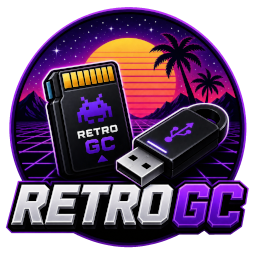
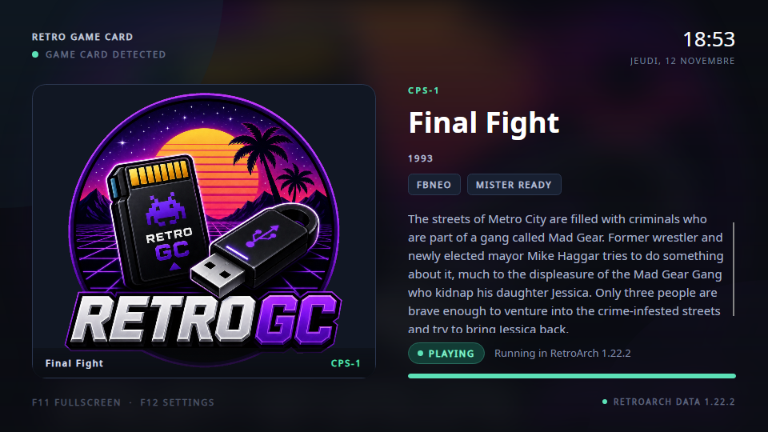
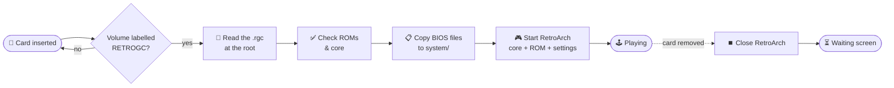
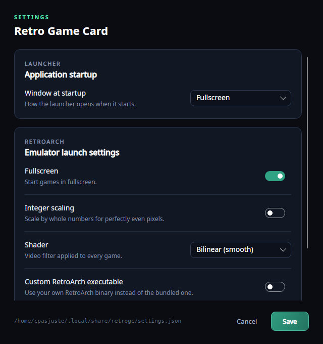
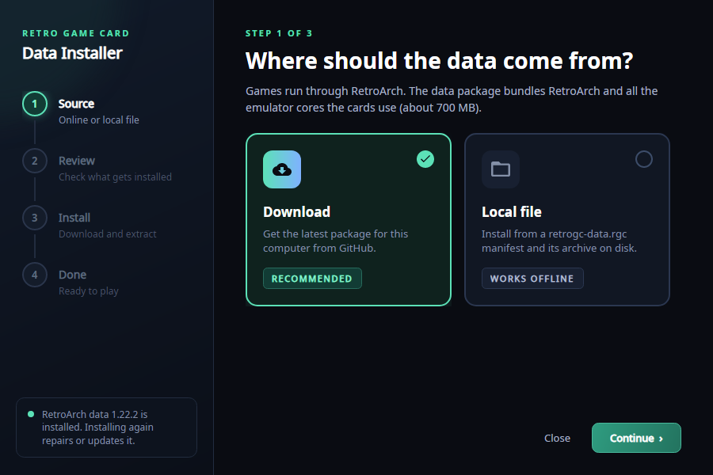
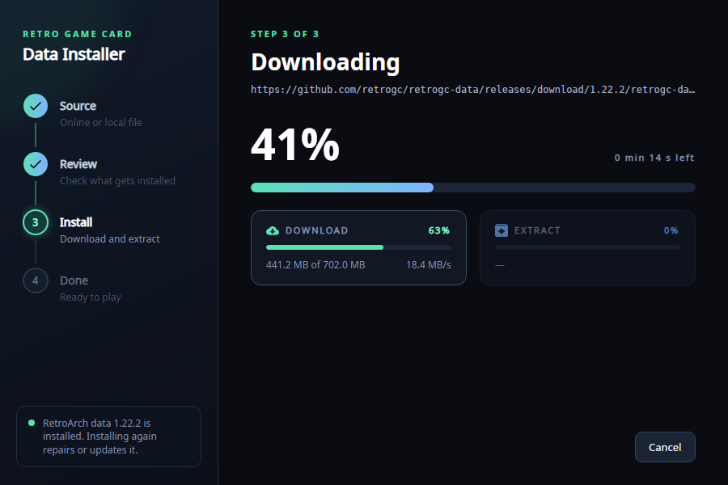

<div align="center">



# Retro Game Card

### 🕹️ Plug in a card. Play the game. That's it.

A portable, self-contained **game card** format for USB sticks and SD cards,
and a launcher that turns any computer into a plug-and-play retro console.

[](https://github.com/retrogc/retrogc-launcher/releases)
[](#%EF%B8%8F-supported-platforms)
[](#%EF%B8%8F-supported-platforms)
[](#-mister-fpga)

[](https://dotnet.microsoft.com/)
[](https://avaloniaui.net/)
[](https://www.retroarch.com/)
[](LICENSE)

**[🚀 Quick start](#-quick-start)** ·
**[🎴 Card format](#-the-rgc-card-format)** ·
**[🧩 Make a card](#-creating-a-card)** ·
**[⚙️ Settings](#%EF%B8%8F-settings)** ·
**[❓ FAQ](#-faq--troubleshooting)** ·
**[🧑‍💻 Build](#-building-from-source)**

<br />



</div>

---

## ✨ Why Retro Game Card?

<table>
<tr>
<td width="50%" valign="top">

### 💾 One game, one card
Everything a game needs lives **on the card**: ROMs, BIOS files, cover art and a
small `.rgc` description file. Nothing to configure on the computer.

</td>
<td width="50%" valign="top">

### ⚡ Insert and play
The launcher watches your drives. Plug a card in and the game **starts automatically**.
Pull it out and you're back to the waiting screen.

</td>
</tr>
<tr>
<td valign="top">

### 🖼️ Real shelf presence
Cover art, title, platform, year, developer and genre on a polished,
TV-friendly fullscreen screen. A modern take on the cartridge shelf.

</td>
<td valign="top">

### 🔁 Same card, everywhere
A single `.rgc` file describes both the **RetroArch** (Windows / Linux) and the
**MiSTer FPGA** launch, so one card works on a PC *and* on a MiSTer.

</td>
</tr>
<tr>
<td valign="top">

### 🗃️ Preservation friendly
A card is just files on a FAT32 volume. Copy it, back it up, share it as a
compressed image: it keeps working years later.

</td>
<td valign="top">

### 📦 Batteries included
The launcher downloads and installs RetroArch and every emulator core for you,
in a guided installer. No RetroArch knowledge needed.

</td>
</tr>
</table>

---

## 🖥️ Supported platforms

| | Platform | What you run | Notes |
|:-:|---|---|---|
| 🪟 | **Windows** x64 | `retrogc-launcher.exe` | Standalone, self-contained build |
| 🐧 | **Linux** x64 | `retrogc-launcher` | Standalone, self-contained build |
| 🔲 | **MiSTer FPGA** | `retrogc.sh` | Background script, no desktop app needed |

> [!NOTE]
> The card format is **identical** on all three. Each `.rgc` file carries a `retroarch` section
> (Windows / Linux) and an optional `misterfpga` section.

---

## 🚀 Quick start

### 🪟 🐧 Windows & Linux

| Step | |
|:-:|---|
| **1️⃣ Download** | Grab the launcher for your system from the [**releases page**](https://github.com/retrogc/retrogc-launcher/releases). |
| **2️⃣ Run** | Start `retrogc-launcher`. On first launch, the **data installer** opens and sets up RetroArch and its cores (≈ 700 MB). |
| **3️⃣ Get a card** | Write a card image to a USB stick or SD card (see [Writing a card image](#-writing-a-card-image)), or [make your own](#-creating-a-card). Ready-made cards live in [**retrogc-gamecards**](https://github.com/retrogc/retrogc-gamecards). |
| **4️⃣ Play** | Insert the card. The game starts on its own. 🎉 |

> [!TIP]
> Closing the window doesn't quit: the launcher keeps running in the **system tray** so cards
> keep working. Use the tray menu → **Exit** to really quit.

<details>
<summary><b>📥 Installing the data package by hand (offline machines)</b></summary>

<br />

1. Download the archive for your system from
   [**retrogc-data releases**](https://github.com/retrogc/retrogc-data/releases),
   e.g. `retrogc-data-1.22.2-linux.zip`.
2. Either:
   - open the installer (<kbd>F12</kbd> → **RetroArch data package** → **Install…**), choose
     **Local file** and pick the `retrogc-data.rgc` manifest sitting next to the archive, **or**
   - extract the archive yourself into `<data folder>/1.22.2/`
     (see [Where things are stored](#-where-things-are-stored)).

</details>

### 🔲 MiSTer FPGA

1. **Download** [`retrogc.sh`](https://raw.githubusercontent.com/retrogc/retrogc-launcher/refs/heads/main/Platforms/MisterFPGA/retrogc.sh).
2. **Copy** it to `/media/fat/Scripts/retrogc.sh` and make it executable:
   ```bash
   chmod a+x /media/fat/Scripts/retrogc.sh
   ```
3. **Run** it from *Main menu → Scripts → retrogc.sh*.

Running the script **toggles** the background watcher:

| | When turned **ON** | When turned **OFF** |
|:-:|---|---|
| 🪝 | Installs a hook in `/media/fat/linux/user-startup.sh` | Removes the hook |
| 👀 | Starts watching for cards right away | Stops the watcher |
| 🔄 | Starts again automatically on every boot | Cleans up and returns to the menu core |

📖 More details in [`readme-misterfpga.txt`](Platforms/MisterFPGA/readme-misterfpga.txt).

---

## 🎴 The `.rgc` card format

A card is a **FAT32 volume labelled `RETROGC`** with one `.rgc` JSON file at its root, plus the
files it points to.

```text
📀 RETROGC/                         ← volume label (required)
├── 📄 mygame.rgc                   ← card definition (required, at the root)
├── 🖼️ mygame.png                   ← cover art (optional)
└── 📁 games/
    └── 📁 nes/
        └── 🎮 Super Mario Bros. (World).nes
```

> [!IMPORTANT]
> Only a `.rgc` file **at the root** of the volume is read, and only the **first one** found.
> Keep exactly one `.rgc` per card.

### 🏷️ Root fields

| Field | Type | Required | Description |
|---|:-:|:-:|---|
| `name` | string | ✅ | Game title shown on screen. |
| `description` | string | | Short blurb shown under the title. |
| `platform` | string | | Platform tag, e.g. `NES`, `CPS-1`, `PSX`. |
| `year` | string | | Release year, e.g. `1989`. |
| `image` | string | | Cover art (PNG), relative to the `.rgc` file. |
| `developer` | string | | 🆕 Developer / studio, e.g. `Capcom`. |
| `genre` | string | | 🆕 Genre badge, e.g. `Beat 'em up`. |
| `players` | string | | 🆕 Player count badge, e.g. `1-2`. |
| `retroarch` | object | ✅ | How to launch the game with RetroArch ⬇️ |
| `misterfpga` | object | | How to launch the game on a MiSTer ⬇️ |

> [!NOTE]
> 🆕 `developer`, `genre` and `players` are **display-only** and fully backward compatible: older
> launchers and the MiSTer script just ignore them, and cards without them work as before.

### 🕹️ `retroarch` object

| Field | Type | Required | Description |
|---|:-:|:-:|---|
| `core` | string | ✅ | Libretro core name **without** suffix, e.g. `nestopia`, `fbneo`, `swanstation`. The launcher adds `_libretro.dll` (Windows) or `_libretro.so` (Linux). |
| `roms` | string[] | ✅ | ROM file(s), relative to the `.rgc`. The **first** one is launched; the others must exist (e.g. extra PSX discs). |
| `version` | string | ✅ | RetroArch version the card was made for, e.g. `1.22.2`. If it isn't installed, the newest installed version is used. |
| `runtimes` | string[] | | System / BIOS files copied into RetroArch's `system` folder before launch, e.g. `games/neogeo/neogeo.zip`. |

### 🔲 `misterfpga` object

| Field | Type | Required | Description |
|---|:-:|:-:|---|
| `core` | string | ✅ | `.rbf` core, relative to the **SD card root**, e.g. `_Console/NES_20260603.rbf`. |
| `roms` | string[] | ✅ | ROM file(s), relative to the **SD card root**. The first one is loaded; arcade games usually point to a `.mra`. |
| `runtimes` | string[] | | Extra system files needed by the core (Neo Geo BIOS, PSX boot ROMs…). |
| `delay` | string | | Load delay written to the generated `.mgl`. Default `1`. |
| `index` | string | | ROM index written to the generated `.mgl`. Default `1`. |
| `type` | string | | ROM type for the `.mgl`: `f` (file) or `s` (stream). Default `f`. |

> [!TIP]
> `delay`, `index` and `type` only matter for non-`.mra` ROMs on MiSTer. Arcade `.mra` files are
> loaded directly and ignore them.

### 🧭 Path rules

| | Rule |
|:-:|---|
| 📐 | Every path in a `.rgc` is **relative**, never absolute. |
| 🔒 | `retroarch` paths are relative to the `.rgc` file and **can't escape** the card (`../` is rejected). |
| 🔀 | `misterfpga` paths are relative to the **SD card root**, because MiSTer cores and `.mra` files live in its own `_Console` / `_Arcade` folders. |
| 🖼️ | A missing `image` is fine: a placeholder is shown instead. |

### 📝 Example

<details open>
<summary><b>Full card</b>, every field</summary>

```json
{
  "name": "Super Mario Bros",
  "description": "Mario and Luigi race to rescue Princess Peach from the evil Bowser...",
  "platform": "NES",
  "year": "1989",
  "image": "mario.png",
  "developer": "Nintendo",
  "genre": "Platformer",
  "players": "1-2",
  "retroarch": {
    "version": "1.22.2",
    "core": "nestopia",
    "roms": [
      "games/nes/Super Mario Bros. (World).nes"
    ]
  },
  "misterfpga": {
    "core": "_Console/NES_20260603.rbf",
    "roms": [
      "games/nes/Super Mario Bros. (World).nes"
    ],
    "delay": "2",
    "index": "1",
    "type": "f"
  }
}
```

</details>

<details>
<summary><b>Minimal card</b>, RetroArch only</summary>

```json
{
  "name": "Super Mario Bros",
  "retroarch": {
    "version": "1.22.2",
    "core": "nestopia",
    "roms": [ "games/nes/Super Mario Bros. (World).nes" ]
  }
}
```

</details>

📚 More examples in the [**Cards**](Cards) folder (the reference), and complete prebuilt cards in
[**retrogc-gamecards**](https://github.com/retrogc/retrogc-gamecards).

---

## 🧩 Creating a card

1. 📋 **Copy** a `.rgc` from the [Cards](Cards) folder and adapt it to your game.
2. 📁 **Add** the files it references, keeping the folder layout.
3. 💾 **Format** a USB stick / SD card as **FAT32** with the label **`RETROGC`** and copy everything to it,
   or build an image (below).
4. 🔌 **Plug it in.** If something is wrong, the launcher shows the reason on screen.

### 💿 Card images (Linux)

[`retrogc-image.sh`](Platforms/Linux/retrogc-image.sh) builds, writes and unpacks compressed card images:

```bash
# 📦 folder → compressed image (FAT32, labelled RETROGC, xz compressed)
./retrogc-image.sh --build ~/my-card my-card.img.xz

# 🔥 image → USB stick / SD card  (⚠️ erases the whole device, asks first)
./retrogc-image.sh --restore my-card.img.xz /dev/sdb

# 📂 image → folder (inspect or edit an existing card)
./retrogc-image.sh --extract my-card.img.xz ./my-card
```

<details>
<summary><b>🔧 Dependencies</b></summary>

| Mode | Tools |
|---|---|
| `--build` | `parted` `mkfs.fat` `mount` `umount` `rsync` `xz` `truncate` `mcopy` |
| `--restore` | `xzcat` `dd` `lsblk` |
| `--extract` | `xz` `mcopy` `find` `mktemp` `realpath` |

`mcopy` comes from the **mtools** package.

</details>

### 🔥 Writing a card image

| | How |
|:-:|---|
| 🐧 **Linux** | `./retrogc-image.sh --restore game.img.xz /dev/sdX` |
| 🪟 **Windows** | Open the `.img.xz` with [**balenaEtcher**](https://etcher.balena.io/) and flash it |

---

## 🔍 How auto-launch works



1. The launcher checks the removable drives twice a second for a volume labelled `RETROGC`.
2. It reads the `.rgc` at the root and shows the game on screen.
3. It checks every ROM and the core, then copies the `runtimes` (BIOS) files into RetroArch's
   `system` folder, but only when they changed.
4. It starts RetroArch with the core and the ROM, using your fullscreen, scaling and shader settings.
5. When the card is pulled out, RetroArch is asked to close (and is stopped after 3 seconds if
   needed), then the launcher goes back to waiting.

> [!TIP]
> Quit RetroArch while the card is still in? Press <kbd>Enter</kbd> on the launcher to play again.

---

## ⌨️ Controls

| Key | Action |
|:-:|---|
| <kbd>F11</kbd> / <kbd>Esc</kbd> | Toggle fullscreen / windowed |
| <kbd>F12</kbd> | Open the settings |
| <kbd>Enter</kbd> / <kbd>Space</kbd> | Relaunch the inserted card (after RetroArch was closed or failed) |

From the **tray icon**: click to show the launcher, or right-click for **Open**, **Settings** and **Exit**.

---

## ⚙️ Settings

Press <kbd>F12</kbd> (or tray icon → **Settings**).

<div align="center">

</div>

| Setting | Default | What it does |
|---|:-:|---|
| 🪟 **Window at startup** | Fullscreen | Open the launcher fullscreen, windowed, or minimized to the tray. |
| 🖥️ **Fullscreen** | On | Start games in fullscreen. |
| 📐 **Integer scaling** | Off | Scale by whole numbers for perfectly even pixels. |
| ✨ **Shader** | Bilinear | `None` (sharp pixels), `Bilinear` (smooth), `CRT`, `Retro LCD` or `Scanlines`. |
| 🛠️ **Custom RetroArch executable** | Off | Use your own RetroArch binary instead of the bundled one. |
| 📦 **RetroArch data package** | n/a | Install, repair or update RetroArch and its cores. |

### 📦 The data installer

A guided installer downloads RetroArch and every emulator core the cards use, either **from
GitHub** or **from a local file** for offline machines. It shows speed and time left, can be
cancelled at any time, and never deletes files that aren't part of the package (your saves
are safe when reinstalling).

<div align="center">


</div>

### 📂 Where things are stored

| What | 🐧 Linux | 🪟 Windows |
|---|---|---|
| Settings | `~/.local/share/retrogc/settings.json` | `%LOCALAPPDATA%\retrogc\settings.json` |
| RetroArch data | `~/.local/share/retrogc/data/<version>/` | `%LOCALAPPDATA%\retrogc\data\<version>\` |
| Temporary downloads | `~/.local/share/retrogc/downloads/` | `%LOCALAPPDATA%\retrogc\downloads\` |

---

## ❓ FAQ & troubleshooting

<details>
<summary><b>The card isn't detected</b></summary>

<br />

- Check the volume label is exactly **`RETROGC`**.
- 🐧 On Linux, the card must be **mounted** with a folder named after its label (desktop auto-mounters
  do this, e.g. `/run/media/<user>/RETROGC`).
- 🪟 On Windows, the drive's **volume label** is used.

</details>

<details>
<summary><b>The game doesn't start</b></summary>

<br />

The reason is shown in red on the launcher screen. The most common ones:

- **Core not installed**: the `retroarch.core` name is wrong, or the data package is missing
  (<kbd>F12</kbd> → **RetroArch data package**).
- **Missing game file**: a path in `roms` or `runtimes` doesn't match the card's content
  (paths are case-sensitive on Linux).
- **No .rgc found**: the `.rgc` file must be at the **root** of the card.

</details>

<details>
<summary><b>Multi-disc PSX games</b></summary>

<br />

List every disc file in `roms`. Only the first is launched; the others just need to be there.
See [`psx-metal_gear_solid.rgc`](Cards/psx-metal_gear_solid.rgc).

</details>

<details>
<summary><b>Neo Geo and other BIOS-based systems</b></summary>

<br />

Put the BIOS (e.g. `neogeo.zip`) on the card and list it in `retroarch.runtimes`. It's copied to
RetroArch's `system` folder before every launch. See [`neogeo-metal_slug.rgc`](Cards/neogeo-metal_slug.rgc).

</details>

<details>
<summary><b>Where are the logs?</b></summary>

<br />

Start `retrogc-launcher` from a terminal: every step (card detection, files copied, the exact
RetroArch command line) is printed there.

</details>

---

## 🧑‍💻 Building from source

> Requires the [**.NET 10 SDK**](https://dotnet.microsoft.com/download).

```bash
git clone https://github.com/retrogc/retrogc-launcher.git
cd retrogc-launcher
dotnet run
```

<details>
<summary><b>🗂️ Project layout</b></summary>

```text
Src/
├── 📁 Models/        Card (.rgc), AppSettings, data manifest
├── 📁 Services/      CardMonitor, GameSession, RetroArchLauncher, DataInstaller, paths
├── 📁 ViewModels/    MVVM view models (CommunityToolkit.Mvvm)
├── 📁 Views/         Avalonia windows (compiled bindings)
├── 📁 Styles/        Theme.axaml: shared palette, controls, icons
└── 📁 Assets/        Icons
Cards/                Reference .rgc files
Platforms/
├── 📁 Linux/         retrogc-image.sh
└── 📁 MisterFPGA/    retrogc.sh
```

</details>

<details>
<summary><b>📦 Release builds</b></summary>

<br />

Release builds are self-contained, trimmed, single-file executables, built by the
[**release workflow**](.github/workflows/release.yml):

```bash
dotnet publish -c Release -r linux-x64 --self-contained -p:PublishTrimmed=true -p:PublishSingleFile=true
dotnet publish -c Release -r win-x64   --self-contained -p:PublishTrimmed=true -p:PublishSingleFile=true
```

</details>

---

## 🤝 Contributing

Contributions are welcome! 💜 New example cards, script improvements, UI polish, translations…
open an [issue](https://github.com/retrogc/retrogc-launcher/issues) or a pull request.

## 📄 License

Retro Game Card is free software, released under the
[**GNU General Public License v3.0**](LICENSE). You can use, study, share and modify it;
derived works must stay under the same license.

<div align="center">

<br />

**Made with ❤️ for retro gaming.**

<sub>Retro Game Card ships no games. Only use ROMs you legally own.</sub>

</div>
